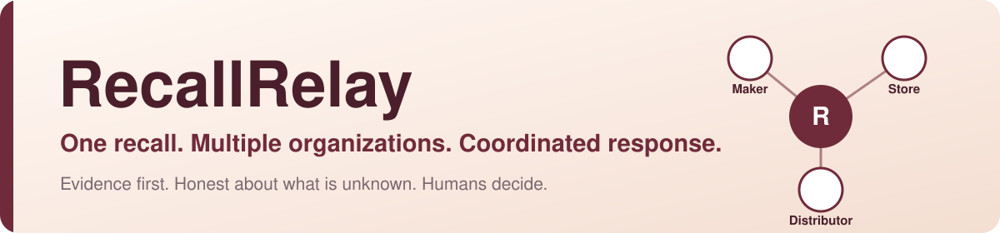
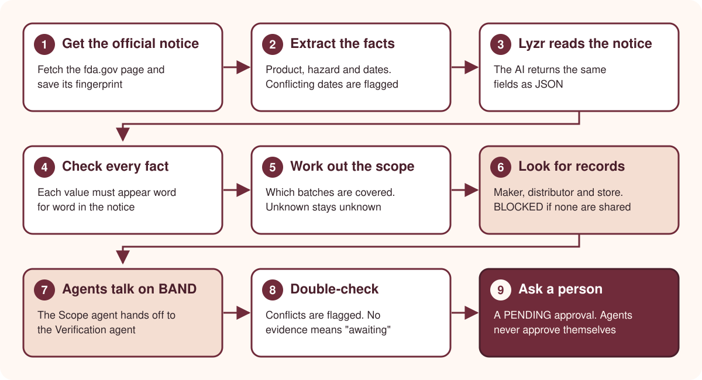
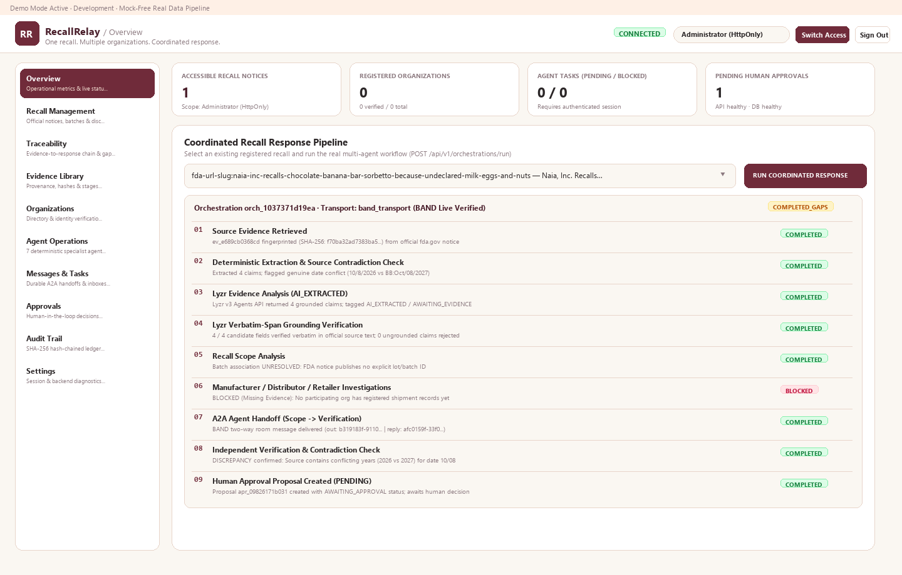
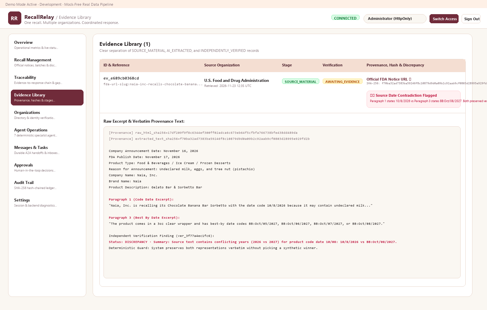
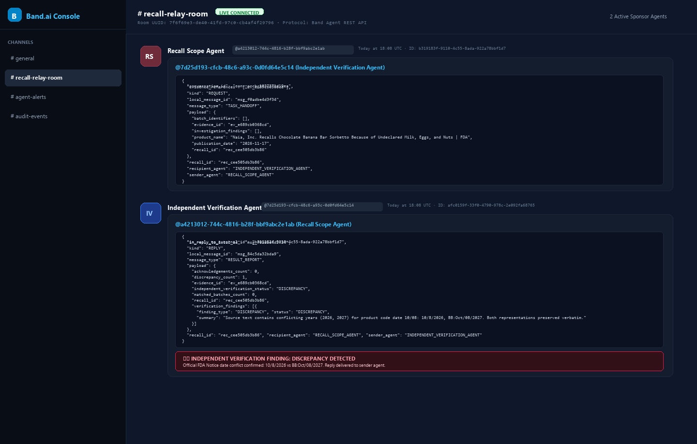
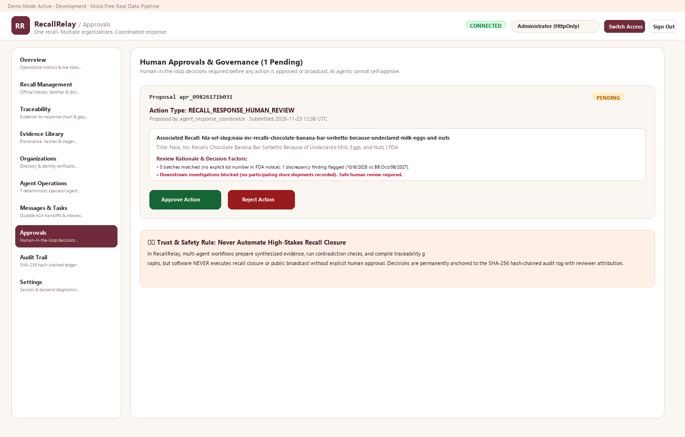

<p align="center">
  
</p>

<p align="center">
  
  
  
  
  
  
</p>

> **Built for the Diwali Festiverse: Agent-to-Agent Hackathon (India Edition) by HiDevs.**
> Demo video: _link added at submission_

---

## The problem

When a food product is recalled, three kinds of companies each hold a piece of the story:

| Who | What they know |
| :-- | :-- |
| The maker | What was produced, and where it was sent |
| The distributor | What arrived, and where it went next |
| The store | What is on its shelves right now |

Today they put the pieces together with emails and spreadsheets. And when an AI tool helps, it tends to **fill the gaps with guesses**: a made-up quantity, a "probably the same date." In a recall, a guess can hurt someone.

## What RecallRelay does

RecallRelay helps these organizations respond to a recall together, using only evidence it can point to.

1. **It reads the official notice** from fda.gov and saves a fingerprint of it, so nobody can quietly change it later.
2. **It pulls out the key facts** (product, hazard, dates) and checks every one against the original text. A fact it can't find word for word is thrown out.
3. **It splits the work between agents** that pass tasks to each other. Two of them talk through a real [BAND](https://www.band.ai/) room.
4. **It says "unknown" when something is unknown.** Software only *proposes* an action. A person approves it.

> **The one rule: never invent what you don't know.**

---

## A real example: the Naia sorbetto recall

On 16 November 2026, Naia, Inc. recalled its **Chocolate Banana Bar Sorbetto** because it may contain undeclared milk, eggs and pistachio. We imported the real [FDA notice](https://www.fda.gov/safety/recalls-market-withdrawals-safety-alerts/naia-inc-recalls-chocolate-banana-bar-sorbetto-because-undeclared-milk-eggs-and-nuts) and ran RecallRelay on it.

| What we looked at | What RecallRelay did |
| :-- | :-- |
| The source | Saved the page with a SHA-256 fingerprint of both the raw page and the extracted text |
| The dates | The FDA notice says `10/8/2026` in one paragraph and `BB:Oct/08/2027` in another. RecallRelay **shows both and picks neither** |
| The batch number | The notice gives no lot number, so the batch is marked **unresolved** instead of guessed |
| Shipments and store stock | No organization has shared records yet, so this step shows **BLOCKED**, not "zero" |
| What happens next | A **PENDING** request is created for a person to review |

---

## How it works

One click on **Run Coordinated Response** runs nine steps. Each step is saved, so the timeline survives a page refresh.

<p align="center">
  
</p>

| Step | What happens | If something is missing |
| :-: | :-- | :-- |
| 1 | The official page is fetched and fingerprinted | The run stops with an error |
| 2 | Facts are pulled out with fixed rules; conflicting dates are flagged | Missing facts are listed as missing |
| 3 | Lyzr reads the notice and returns the same fields | Skipped if Lyzr is not set up |
| 4 | Each Lyzr value must appear word for word in the notice | Values that don't are marked `UNGROUNDED` and left out |
| 5 | Works out which batches the recall covers | Unknown quantities stay unknown |
| 6 | Looks for records from makers, distributors and stores | Shows `BLOCKED` if nobody has shared any |
| 7 | One agent hands work to another through BAND | Falls back to the built-in local messaging if BAND is off |
| 8 | A second agent double-checks the claims | Shows `AWAITING_EVIDENCE` rather than guessing |
| 9 | A request is created for a person to review | Never approves itself |

---

## The seven agents

Each agent has one job and can only see what it is allowed to see.

| # | Agent | Its job | How it works |
| :-: | :-- | :-- | :-- |
| 1 | **Recall Source Analyst** | Reads the notice and extracts the facts | Fixed rules, plus Lyzr (every value is checked against the source) |
| 2 | **Recall Scope** | Decides which batches are covered | Fixed rules |
| 3 | **Manufacturer Operations** | Checks the maker's own shipment records | Fixed rules, needs the maker's records |
| 4 | **Distributor Reconciliation** | Compares what came in with what went out | Fixed rules, needs the distributor's records |
| 5 | **Retailer Inventory** | Reads a store's stock records (read-only) | Fixed rules, needs the store's records |
| 6 | **Independent Verification** | Double-checks claims and flags conflicts | Fixed rules, replies over BAND |
| 7 | **Response Coordinator** | Tracks progress and asks a person to approve | Fixed rules |

**To be clear about what uses what:** only the Source Analyst uses an AI model (Lyzr), and only the Scope and Verification agents talk through BAND. The rest follow fixed rules. That is deliberate: for a safety task, predictable beats clever.

---

## Built with

| Tool | What we used it for | Status |
| :-- | :-- | :-- |
| **[BAND](https://www.band.ai/)** | Two agents send and reply in a shared room. Both message IDs are saved | Live verified, 23 Nov 2026 |
| **[Lyzr](https://www.lyzr.ai/)** | Reads the notice and returns fields as JSON, which the app then checks | Live verified, 23 Nov 2026 |
| **[AdaL](https://adalagent.ai/)** | Used to make the demo video | See the video link above |
| **[Finch](https://www.finchtech.ai/)** | Adapter written, but not connected in this build | Not live |
| **[Agent37](https://www.agent37.com/)** | Needs a payment card to start, so we did not use it | Not used |

---

## Screenshots

| | |
| :-: | :-: |
| <br>**Overview:** the nine-step run | <br>**Evidence:** source, fingerprint, date conflict |
| <br>**BAND:** two agents, real message IDs | <br>**Approvals:** a person decides |

---

## Trust and safety

- **People stay in charge.** Agents can only create a `PENDING` request. They cannot approve their own work.
- **Organizations keep their data.** Each one sees only its own records, unless it shares specific fields on purpose.
- **A tamper-evident log.** Every action is written to an audit log where each entry's fingerprint depends on the one before it, so edits, deletions and reordering show up. *(Limit: this cannot detect someone replacing the whole database.)*
- **Safe sign-in.** The browser holds only a secure session cookie. The admin key never sits in the browser, and sign-in attempts are rate-limited.
- **Careful with outside data.** Imports accept only `fda.gov` and `api.fda.gov` over HTTPS, with no redirects and a size limit.

## What RecallRelay does not do

We would rather be clear than impressive.

- It is **not a regulator** and does not decide whether a product is unsafe.
- It does **not have access to company databases.** Maker, distributor and store records appear only when those organizations provide them.
- It does **not pull products off shelves.** It prepares a response for a person to approve.
- Our demo uses **one real recall** with no downstream records, so the investigation step honestly shows `BLOCKED`.
- Only **two agents use BAND** and only **one uses Lyzr.**

---

## Run it yourself

You need **Python 3.11+** and **Node.js 18+**. These commands are for Windows PowerShell.

```powershell
git clone https://github.com/mohamad-shafeez/recall-relay.git
cd recall-relay

# 1. Create your settings file (never commit .env)
Copy-Item .env.example .env
Copy-Item frontend\.env.example frontend\.env
# Open .env and set ADMIN_API_KEY to a long random string

# 2. Backend
cd backend
py -3.11 -m venv .venv
.\.venv\Scripts\Activate.ps1
pip install -r requirements.txt

# 3. Frontend (builds the pages the backend serves)
cd ..\frontend
npm install
npm run build

# 4. Start the app
cd ..\backend
uvicorn app.main:app --host 127.0.0.1 --port 8000
```

Open **http://localhost:8000** and sign in with your `ADMIN_API_KEY`.

**Run the tests:**
```powershell
cd backend
pip install -r requirements-dev.txt
pytest -v
```

**Latest local run (Python 3.11.7):** 61 backend tests pass, the TypeScript type check is clean, and the production frontend build succeeds.

**Turn on BAND and Lyzr (optional).** Add your own keys to `.env`, then check them one at a time:
```powershell
python scripts\lyzr_smoke.py
python scripts\band_smoke.py
```
Once both pass, set `A2A_TRANSPORT=band` in `.env` and restart. Without keys, RecallRelay still works using its built-in local messaging.

**Import a real recall.** Use the admin endpoint `POST /api/v1/recalls/import/fda-page` with an fda.gov recall page URL. There is also an openFDA importer under `/api/v1/recalls/import/openfda/`.

**Docker** (uses the built-in local messaging, not BAND):
```powershell
docker compose up --build
```

---

## Tech stack

| Part | Technology |
| :-- | :-- |
| Backend | Python, FastAPI, Pydantic v2 |
| Database | SQLite, with step-by-step migrations that keep existing data |
| Frontend | React, TypeScript, Vite, Tailwind CSS |
| Agent messaging | Built-in SQLite transport, or BAND (Band Agent REST API) |
| AI reading | Lyzr v3 Agents API |
| Evidence | SHA-256 fingerprints and a hash-chained audit log |

---

## Hackathon

| | |
| :-- | :-- |
| **Event** | Diwali Festiverse: Agent-to-Agent Hackathon (India Edition), HiDevs |
| **Track** | Research: Data & Build |
| **How it fits** | A data side gathers official recall evidence. A builder side turns it into a working response dashboard |
| **Built by** | mohamad shafeez |
| **Demo video** | _link_ |

<p align="center"><sub>RecallRelay: the most useful thing it can say is sometimes "we don't know yet."</sub></p>